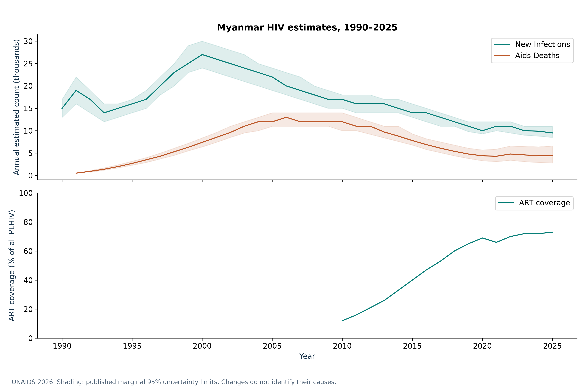
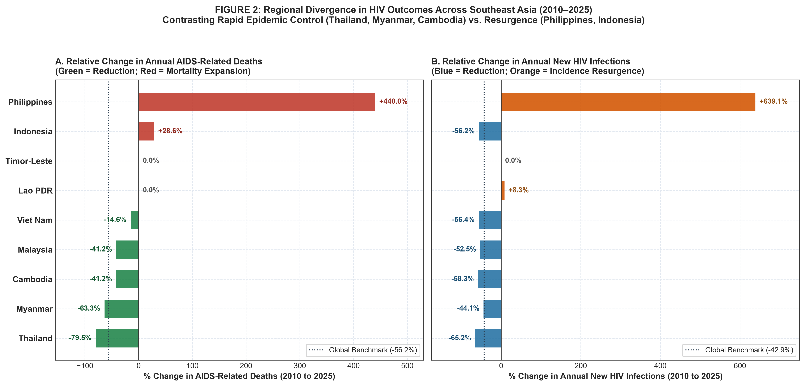
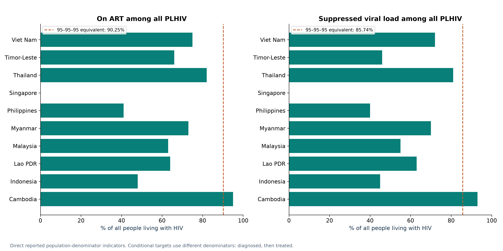
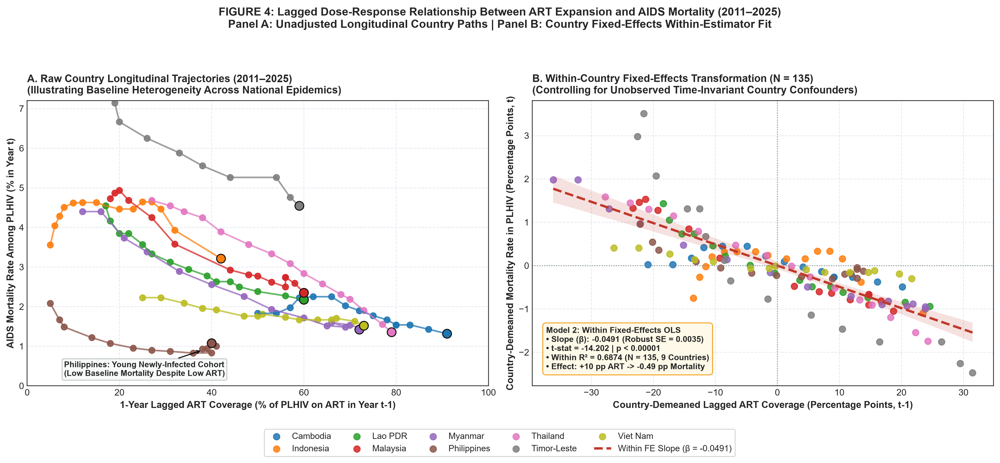
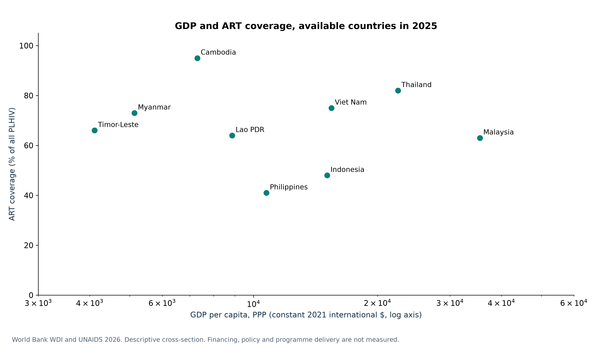
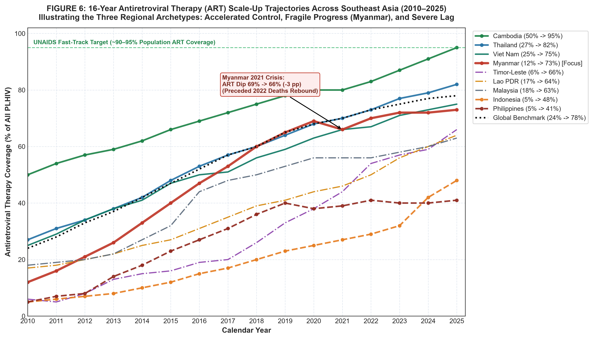

# HIV Epidemiological Transitions and Treatment Disparities in Southeast Asia (1990–2025)

### A Comparative Longitudinal Analysis of Myanmar Against Regional and Global Benchmarks

[](https://hiv-epidemiology-and-treatment-analytics-acm.streamlit.app/)
[](https://github.com/AungChitMoe1995/hiv-epidemiology-and-treatment-analytics)

[](https://hiv-epidemiology-and-treatment-analytics-acm.streamlit.app/)
[](https://github.com/AungChitMoe1995/hiv-epidemiology-and-treatment-analytics/actions/workflows/ci.yml)
[-success.svg)](https://github.com/AungChitMoe1995/hiv-epidemiology-and-treatment-analytics/actions/workflows/ci.yml)
[](LICENSE)
[](https://www.python.org/)
[](https://www.sqlite.org/)
[](https://aidsinfo.unaids.org/)
[](https://www.who.int/data/gho)
[](https://data.worldbank.org/)

> ### 🌐 **Live Interactive Surveillance Dashboard:**
> **👉 [https://hiv-epidemiology-and-treatment-analytics-acm.streamlit.app/](https://hiv-epidemiology-and-treatment-analytics-acm.streamlit.app/)**  
> *Explore 36-year longitudinal HIV trajectories, UNAIDS 95-95-95 cascade gaps, country fixed-effects econometric models, GDP-vs-ART bubble charts, and a real-time **SQLite Query Console** directly in your browser.*

---

## 1. Executive Summary & Clinical Background

**Author:** Dr. Aung Chit Moe — Medical Doctor (MBBS, Myanmar) & Healthcare Data Analyst  
**Focus:** Healthcare Analytics, Clinical Epidemiology, and Health Systems Research  

The global expansion of combination antiretroviral therapy (ART) over the last three decades has fundamentally transformed HIV from an acute fatal illness into a manageable chronic condition. However, across Southeast Asia—a region of over 680 million people—national epidemiological trajectories have diverged starkly.

This project builds an **end-to-end, fully reproducible epidemiological analytics pipeline** investigating:
1. **Long-Term Trajectories (1990–2025):** 36-year trends in incidence, adult prevalence, AIDS-related mortality, and people living with HIV (PLHIV) across 10 Southeast Asian nations and global benchmarks.
2. **The Myanmar Experience:** The dramatic scale-up of decentralized ART from 12% to 69% (2010–2020), the 2021–2022 sociopolitical and COVID-19 health system shock (+11.6% mortality rebound), and the clinical *prevalence paradox*.
3. **Regional Fast-Track Divergences:** Highlighting the contrast between regional leaders (Thailand, Cambodia) and severe counter-epidemics (the Philippines, Indonesia).
4. **UNAIDS 95-95-95 Cascade Performance:** 2025 testing, treatment, and viral suppression metrics, quantifying regional treatment gaps.
5. **Econometric Lagged Panel Regressions:** Estimating country fixed-effects models ($N=144$ contemporaneous / $N=135$ 1-year lagged country-years) to quantify the within-country protective dose-response relationship between ART expansion and mortality.
6. **Macroeconomic Decoupling:** Demonstrating why national GDP per capita does not dictate HIV treatment success in donor-supported concentrated epidemics.

---

## 2. Quantified Key Findings

| Domain | Key Finding | Quantified Evidence | Clinical & Public Health Significance |
| :--- | :--- | :--- | :--- |
| **Myanmar Trajectory** | Rapid mortality decline via ART expansion | AIDS deaths fell **-63.3%** (12,000 to 4,400) between 2010 and 2025 as ART coverage expanded from **12% to 73%**. | Proves feasibility of rapid vertical ART decentralization in low-income settings. |
| **Prevalence Paradox** | Stable prevalence amidst growing PLHIV cohort | Adult prevalence held flat at **0.9%** while total PLHIV grew from **250k to 310k** and new infections fell **-44.1%**. | ART prevents premature mortality, shifting the disease from acute death to chronic survival. |
| **Health System Shock** | 2021–2022 Disruption & Mortality Rebound | ART coverage slipped from 69% to **66% in 2021**; AIDS deaths rebounded **+11.6%** (4,300 to 4,800 in 2022). | Demonstrates the extreme clinical fragility of continuous ART supply chains during political crises. |
| **The Philippine Crisis** | Alarming Counter-Epidemic Outbreak | Annual new infections surged **+639.1%** (4.6k to 34k); AIDS deaths jumped **+440.0%**; ART coverage lags at **41%**. | Represents one of the fastest-growing HIV crises globally; urgent need for destigmatization and PrEP. |
| **Treatment Burden** | Regional Concentration of Untreated PLHIV | **Indonesia (291k)** and **Philippines (148k)** account for **58.8%** of Southeast Asia's entire untreated HIV burden. | Regional elimination goals depend almost entirely on overcoming barriers in these two archipelagos. |
| **Panel Regression** | Lagged ART Mortality Reduction | Each **10 percentage point increase in lagged ART** yields a **0.49 percentage point decrease in AIDS mortality** in PLHIV. | Highly significant within-country protective association ($\beta = -0.0491, t = -14.20, p < 0.00001, R^2 = 0.687$). |
| **Macroeconomic Decoupling** | Wealth does not guarantee epidemic control | Cambodia (GDP PPP \$7.3k) achieved **95% ART**; Indonesia (GDP PPP \$15.1k) achieved only **48% ART**. | In concentrated epidemics, Global Fund grant execution and harm reduction outweigh GDP. |

---

## 3. Authoritative Data Sources & Provenance

Every dataset utilized in this project was programmatically downloaded, inspected, and validated (`src/validation/data_audit.py`). **No synthetic data, simulated counts, or unverified schemas were used.**

- **UNAIDS 2026 Epidemiological Estimates:** Direct download from `aidsinfo.unaids.org` (`Estimates_2026_en.zip`, 22.11 MiB / 23.19 MB compressed; `Estimates_2026_en.csv`, 331.91 MiB / 348.03 MB uncompressed, 2,197,290 rows) and `unaids.org` (`UNAIDS_HIV_estimates_1990_to_present.xlsx`, 5.88 MiB / 6.17 MB). Full 1990–2025 time-series with point estimates and 95% uncertainty intervals.
- **WHO Global Health Observatory (GHO):** REST OData API feeds (`HIV_0000000006`, `HIV_ARTCOVERAGE`, `HIV_0000000026`, `HIV_0000000001`). Programmatically cross-validated in `src/validation/data_audit.py` across **13,191 matched country-year-indicator observations** (`reports/analysis_tables/who_unaids_cross_validation.csv`), confirming **100.00% exact 1:1 numerical agreement** (`Max |diff| = 0.0`, $r = 1.000000$) with UNAIDS estimates.
- **World Bank World Development Indicators (WDI):** REST API feeds for GDP per capita in current US$ (`NY.GDP.PCAP.CD`), PPP constant 2021 international $ (`NY.GDP.PCAP.PP.KD`), and Total Population (`SP.POP.TOTL`).

---

## 4. Repository Structure

```
hiv-epidemiology-and-treatment-analytics/
├── .github/
│   └── workflows/
│       └── ci.yml           # GitHub Actions CI (runs data_audit.py & pytest on push/PR)
├── data/
│   ├── raw/                 # Unmodified original downloads (UNAIDS xlsx & zip, WB csv, WHO csv)
│   ├── processed/           # Cleaned master CSVs and SQLite surveillance database
│   │   ├── hiv_surveillance.db
│   │   ├── hiv_epidemiology_master_1990_2025.csv
│   │   ├── southeast_asia_hiv_longitudinal_1990_2025.csv
│   │   ├── southeast_asia_hiv_panel_2010_2025.csv
│   │   └── regional_global_benchmarks_1990_2025.csv
│   └── metadata/            # Data dictionary, source inventory, country crosswalk
├── sql/
│   ├── 01_create_schema.sql # SQLite DDL schema, dimension, facts, and master view
│   ├── 02_load_data.py      # Automated database loader script
│   ├── 03_analytical_queries.sql # 7 production analytical SQL queries
│   └── 04_run_queries.py    # Query execution and report exporter
├── src/
│   ├── acquisition/         # Automated download pipelines (download_data.py)
│   ├── cleaning/            # Parsing, inequality thresholding, harmonization, metadata
│   ├── validation/          # Internal & WHO-vs-UNAIDS cross-source audit (data_audit.py)
│   ├── analysis/            # Trend decomposition, cascade, and econometric modeling
│   ├── visualization/       # Publication figure generation (300 DPI)
│   └── create_presentation.py # 22-slide uncluttered widescreen PowerPoint deck generator
├── figures/                 # 6 publication-ready figures (PNG, 300 DPI)
├── notebooks/               # Executed Jupyter research notebook & generator script
│   ├── create_notebook.py
│   └── hiv_epidemiology_research.ipynb
├── reports/                 # Scientific research report, SQL exports, cross-source audit logs
│   ├── research_report.md
│   ├── data_quality_audit.md
│   ├── analysis_tables/
│   └── sql_results/
├── dashboard/               # Interactive Streamlit surveillance dashboard
│   └── app.py
├── tests/                   # Pytest test suite (test_data_pipeline.py, 12 tests)
├── docs/                    # Research study protocol and 22-slide PowerPoint presentation
│   ├── study_protocol.md
│   └── presentation/
│       └── hiv_epidemiology_research_briefing.pptx
├── LICENSE                  # MIT License
├── requirements.txt         # Pinned Python dependencies (==)
└── README.md                # Project documentation and reproduction manual
```

---

## 5. Relational Architecture & SQL Analytics

The database `data/processed/hiv_surveillance.db` implements a star schema optimized for surveillance analytics:

- `dim_country`: Primary key `iso3`, containing country names, UN M49 codes, regions, income groups, and analytical roles.
- `fact_hiv_estimates`: 1990–2025 longitudinal estimates (prevalence, deaths, infections, PLHIV) with 95% uncertainty bounds.
- `fact_treatment_cascade`: 2010–2025 UNAIDS Fast-Track cascade data (1st, 2nd, 3rd 95, ART coverage, unreached PLHIV).
- `fact_socioeconomic`: World Bank macroeconomic indicators (GDP per capita current, GDP PPP, Population).
- `v_southeast_asia_surveillance`: Pre-joined master analytical view providing population-standardized rates.

### Sample Analytical Query: Relative Changes & Fast-Track Performance
```sql
WITH base_2010 AS (
    SELECT iso3, country_name, aids_deaths AS deaths_2010, art_coverage_pct AS art_2010
    FROM v_southeast_asia_surveillance WHERE year = 2010
),
current_2025 AS (
    SELECT iso3, aids_deaths AS deaths_2025, art_coverage_pct AS art_2025
    FROM v_southeast_asia_surveillance WHERE year = 2025
)
SELECT 
    b.country_name,
    b.deaths_2010, c.deaths_2025,
    ROUND(((c.deaths_2025 - b.deaths_2010) * 100.0 / b.deaths_2010), 1) AS pct_change_deaths,
    ROUND(c.art_2025 - b.art_2010, 1) AS art_gain_percentage_points
FROM base_2010 b
JOIN current_2025 c ON b.iso3 = c.iso3
WHERE b.deaths_2010 IS NOT NULL
ORDER BY pct_change_deaths ASC;
```

---

## 6. Publication Figures (300 DPI Gallery)

The pipeline automatically compiles 6 publication-grade figures in `figures/`:

### Figure 1: Myanmar 36-Year Epidemic Trajectory & Prevalence Paradox (1990–2025)


### Figure 2: Regional Fast-Track Divergence in Mortality & Incidence (2010 vs. 2025)


### Figure 3: UNAIDS 95-95-95 Treatment Cascade & Unreached PLHIV Burden (2025)


### Figure 4: Lagged ART Dose-Response & Country Fixed-Effects Regression ($N=135$)


### Figure 5: Macroeconomic Decoupling — GDP per Capita (PPP) vs. ART Coverage (2025)


### Figure 6: 16-Year Longitudinal ART Scale-Up Trajectories Across Southeast Asia (2010–2025)


---

## 7. Interactive Streamlit Dashboard (Live Cloud Deployment)

[](https://hiv-epidemiology-and-treatment-analytics-acm.streamlit.app/)

🔗 **Public Production URL:** **[https://hiv-epidemiology-and-treatment-analytics-acm.streamlit.app/](https://hiv-epidemiology-and-treatment-analytics-acm.streamlit.app/)**

The repository includes an interactive Streamlit surveillance application with 5 analytical modules:
- **Module 1 (Overview & Myanmar Focus):** Multi-country temporal metric selector (1990–2025) with clinical annotations.
- **Module 2 (Cascade & Disparities):** Interactive 2025 UNAIDS 95-95-95 target comparison, treatment gap ranking, and regional archetype table.
- **Module 3 (Econometric Modeling):** Dynamic OLS/Fixed-Effects regression scatterplot and 5-specification model summary table.
- **Module 4 (Socioeconomic Determinants):** Logarithmic bubble chart of GDP per capita (PPP) vs. ART coverage.
- **Module 5 (Live SQL Console):** Real-time SQL query editor executing directly against `hiv_surveillance.db` with one-click CSV download.

```bash
# Or launch the dashboard locally:
streamlit run dashboard/app.py
```

---

## 8. Step-by-Step Reproduction Guide

### Prerequisites
- Python 3.10+ (tested on Python 3.12.8)
- SQLite 3

### Installation & Execution
```bash
# 1. Clone repository and navigate to root
git clone https://github.com/AungChitMoe1995/hiv-epidemiology-and-treatment-analytics.git
cd hiv-epidemiology-and-treatment-analytics

# 2. Install dependencies
pip install -r requirements.txt

# 3. Run the automated data cleaning and harmonization pipeline
python src/cleaning/clean_and_harmonize.py

# 4. Build and load the SQLite surveillance database
python sql/02_load_data.py

# 5. Execute analytical SQL queries and export tables
python sql/04_run_queries.py

# 6. Run automated data quality and mathematical audit
python src/validation/data_audit.py

# 7. Run Pytest unit and integration tests
pytest tests/

# 8. Generate statistical models and analysis tables
python src/analysis/epidemiological_trends.py
python src/analysis/cascade_and_disparities.py
python src/analysis/econometric_modeling.py

# 9. Render all publication figures (300 DPI) and 22-slide PowerPoint deck
python src/visualization/generate_figures.py
python src/create_presentation.py

# 10. Launch interactive Streamlit dashboard
streamlit run dashboard/app.py
```

---

## 9. Methodological Limitations

1. **Ecological Fallacy:** As a country-year macro-epidemiological study, findings reflect population-level associations and cannot establish individual-level patient adherence, viral resistance, or clinical outcomes.
2. **Model-Based Estimations:** Data derive from UNAIDS Spectrum compartmental models rather than complete vital registration death registries.
3. **Data Suppression:** Brunei Darussalam suppresses numerical epidemiological estimates due to small case counts, precluding its inclusion in regression models.

---

## AI-Assisted Development

AI coding tools, including Antigravity/Gemini, were used to assist with code generation, implementation, and technical problem-solving during this project.

As the project author, I directed the project goals and overall approach, applied my healthcare knowledge where relevant, and reviewed the implementation and outputs to the extent of my current technical understanding. My background is in medicine and healthcare software workflows, with practical foundational knowledge of Python, SQL, and databases.

AI assistance accelerated implementation, but the project is presented as a transparent demonstration of my healthcare domain knowledge, analytical thinking, and ability to use modern tools to solve practical problems. I do not claim that every line of code was written independently.

---

## 10. Author & Contact

**Investigator:** Dr. Aung Chit Moe — Medical Doctor (MBBS, Myanmar) & Healthcare Data Analyst  
**Specialization:** Healthcare Analytics, Clinical Surveillance, Public Health Research  
**Live Interactive Dashboard:** [https://hiv-epidemiology-and-treatment-analytics-acm.streamlit.app/](https://hiv-epidemiology-and-treatment-analytics-acm.streamlit.app/)  
**Portfolio Repository:** [https://github.com/AungChitMoe1995/hiv-epidemiology-and-treatment-analytics](https://github.com/AungChitMoe1995/hiv-epidemiology-and-treatment-analytics)  

